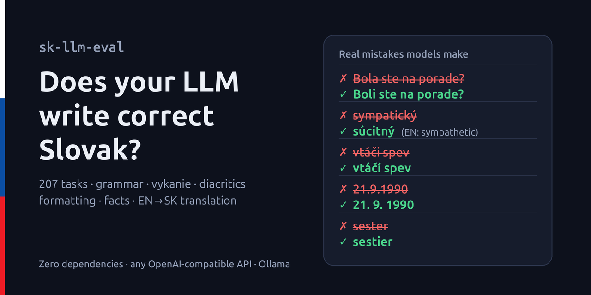

# sk-llm-eval



**Does the model write correct Slovak?** A practical benchmark for Slovak language quality in LLM answers.

[](https://github.com/ltchurik/sk-llm-eval/actions/workflows/validate.yml)
[](https://doi.org/10.5281/zenodo.24091954)


Academic Slovak benchmarks (skLEP, Trojsten) measure language understanding and problem solving. sk-llm-eval measures what a Slovak user or company notices first: declension, *vykanie*, diacritics, dates and money written the Slovak way, Slovak facts without hallucination, and translations without anglicisms or Czech influence.

- **207 tasks in 6 categories**, written for this benchmark, not translated from English.
- **Mostly deterministic checks** (regex, word counts, diacritics ratio). An LLM judge is used only where a regex cannot verify the answer.
- **Zero dependencies.** Python 3.10+ standard library, any OpenAI-compatible API: OpenAI, OpenRouter, Ollama, vLLM, LM Studio…
- **Reproducible.** Every answer and every judge verdict behind the leaderboard is committed.

## Leaderboard (v0.2.1)

18 models: 4 Claude models and 14 open-weight models run locally.

| # | Model | Overall | format | gramatika | long_text | preklad | realie | register |
|---|---|---|---|---|---|---|---|---|
| 1 | Claude Fable 5.1 (chat) | **100.0** | 100.0 | 100.0 | 100.0 | 100.0 | 100.0 | 100.0 |
| 2 | Claude Opus (agent) | **100.0** | 100.0 | 100.0 | 100.0 | 100.0 | 100.0 | 100.0 |
| 3 | Claude Sonnet (agent) | **94.4** | 100.0 | 98.6 | 76.9 | 92.9 | 97.9 | 100.0 |
| 4 | Claude Haiku (agent) | **93.1** | 97.4 | 94.2 | 84.6 | 92.9 | 93.6 | 96.2 |
| 5 | Gemma 4 26B-A4B (Ollama) | **75.9** | 86.8 | 75.4 | 30.8 | 92.9 | 85.1 | 84.6 |
| 6 | Qwen 3.8 27B Q8 (Ollama, no thinking) | **70.4** | 84.2 | 69.6 | 38.5 | 92.9 | 63.8 | 73.1 |
| 7 | Gemma 4 12B (Ollama) | **60.1** | 73.7 | 62.3 | 7.7 | 85.7 | 61.7 | 69.2 |
| 8 | Gemma 3 12B (Ollama) | **58.9** | 63.2 | 63.8 | 30.8 | 78.6 | 59.6 | 57.7 |
| 9 | Ornith 1.5 35B (Ollama) | **58.5** | 73.7 | 56.5 | 23.1 | 71.4 | 72.3 | 53.8 |
| 10 | Qwen 3.5 9B (Ollama, no thinking) | **52.9** | 63.2 | 55.1 | 15.4 | 85.7 | 59.6 | 38.5 |
| 11 | Gemma 4 E4B (Ollama) | **47.3** | 52.6 | 47.8 | 15.4 | 78.6 | 51.1 | 38.5 |
| 12 | Laguna XS 2.1 Q8 (Ollama) | **41.5** | 63.2 | 34.8 | 7.7 | 64.3 | 59.6 | 19.2 |
| 13 | Qwen 3.5 4B (Ollama, no thinking) | **39.9** | 63.2 | 49.3 | 7.7 | 57.1 | 42.6 | 19.2 |
| 14 | Gemma 3 4B (Ollama) | **36.6** | 34.2 | 37.7 | 7.7 | 71.4 | 34.0 | 34.6 |
| 15 | Granite 4.1 8B (Ollama) | **34.8** | 52.6 | 43.5 | 7.7 | 42.9 | 42.6 | 19.2 |
| 16 | Mistral Nemo 12B (Ollama) | **21.3** | 39.5 | 31.9 | 0.0 | 0.0 | 44.7 | 11.5 |
| 17 | Llama 3.2 3B (Ollama) | **14.5** | 18.4 | 24.6 | 7.7 | 7.1 | 21.3 | 7.7 |
| 18 | Phi-4 mini 3.8B (Ollama) | **13.0** | 18.4 | 15.9 | 0.0 | 14.3 | 25.5 | 3.8 |

Score = % of tasks that passed all their checks; Overall = mean of the category scores. The full table with judge and dates is in [`results/LEADERBOARD.md`](results/LEADERBOARD.md). Read [how the rows were produced](#how-the-rows-were-produced) before you compare them.

## What models get wrong

Real answers from the 18 runs above:

| Task | Expected | Wrong answers seen |
|---|---|---|
| Seat of the Constitutional Court | Košice | Bratislava (13 of 18 models) |
| Largest self-governing region | Banskobystrický | Košický, Prešovský (13 of 18) |
| *He is a very sympathetic person.* | *súcitný, empatický* | *sympatický* (11 of 18) |
| VAT rate since 1 January 2025 | 23 % | 20 % (11 of 18) |
| *sestra*, genitive plural | *sestier* | *sester*, *sestr* (10 of 18) |
| Date 21 Sep 1990 in numbers | *21. 9. 1990* | *21.9.1990*, *21. septembra 1990* (8 of 18) |
| *vtáči* or *vtáčí spev*? | *vtáčí* (exception to the rhythmic law) | *vtáči* (5 of 18) |
| *Bola si včera na porade?* → *vykanie* | *Boli ste…* | *Bola ste…*, a Czech pattern (4 of 18) |

Some small models drift into a neighbouring language: Mistral Nemo translated *Eventually, we found the problem* as *Končno smo našli problem*, which is Slovenian.

## Categories

| Category | Tasks | What it measures |
|---|---|---|
| `gramatika` | 69 | declension, i/y, rhythmic law and its exceptions, verb forms, numbers in words, bohemisms, capitalisation |
| `realie` | 47 | Slovak institutions, law, geography and history; hallucination traps |
| `format` | 38 | dates, numbers, currency, phone numbers, postal codes, titles, abbreviations, quotation marks |
| `register` | 26 | *vykanie* vs. *tykanie*, salutations, formal letters, standard vs. colloquial style |
| `preklad` | 14 | EN→SK: idioms, false friends (*actual*, *eventually*, *sympathetic*), gender and case agreement |
| `long_text` | 13 | 100–300-word texts: consistent diacritics and register, no anglicisms, restoring stripped diacritics |

Prompts and rubrics are in Slovak on purpose: the benchmark tests how a model behaves for a Slovak user.

## Quick start

```bash
git clone https://github.com/ltchurik/sk-llm-eval && cd sk-llm-eval

# OpenAI
export OPENAI_API_KEY=sk-...
python -m sk_llm_eval.run --model gpt-4o --judge-model gpt-4o

# OpenRouter: one key, every model
export SK_EVAL_API_KEY=sk-or-...
python -m sk_llm_eval.run --base-url https://openrouter.ai/api/v1 \
  --model mistralai/mistral-large --judge-model openai/gpt-4o

# local model via Ollama
python -m sk_llm_eval.run --base-url http://localhost:11434/v1 --model qwen2.5:7b

# rebuild the leaderboard from results/*.json
python -m sk_llm_eval.leaderboard
```

Without `--judge-model`, the judge tasks are skipped and left out of the score; deterministic tasks always run.

### Reasoning and local models

```bash
# give a reasoning model room to think…
python -m sk_llm_eval.run --base-url http://localhost:11434/v1 --model my-model \
  --max-tokens 8192 --timeout 900

# …or switch thinking off
python -m sk_llm_eval.run --base-url http://localhost:11434/v1 --model my-model \
  --max-tokens 1500 --extra-body '{"reasoning_effort": "none"}'
```

- Answers are appended to `results/answers/<model>.jsonl` as they arrive. If a run dies, `--resume` continues it and only tasks without an answer hit the API.
- `<think>…</think>` blocks are stripped before checking.
- `--extra-body` merges any JSON into the request body.

### Scoring answers collected elsewhere

For chat-only models, or to re-score a run after checks change, put the answers in a JSONL file with one `{"id": "...", "answer": "..."}` per line:

```bash
python -m sk_llm_eval.score --answers results/answers/my-model.jsonl --label "My Model (chat)"
# judge verdicts collected separately
python -m sk_llm_eval.score --answers ... --label ... --judge-file verdicts.jsonl --judge-label "GPT-4o"
```

## How scoring works

Every task has a list of checks, and a task **passes only if all its checks pass**.

```jsonc
{
  "id": "register-024",
  "category": "register",
  "prompt": "Prepíš do vykania. Otázka je adresovaná žene: Bola si včera na porade?",
  "checks": [
    {"type": "regex", "value": "\\bBoli ste\\b", "flags": "i"},
    {"type": "not_regex", "value": "\\bBola ste\\b", "flags": "i"}
  ]
}
```

| Check | Meaning |
|---|---|
| `contains` / `not_contains` | case-insensitive substring |
| `exact` | normalised answer equals the value |
| `regex` / `not_regex` | `re.search`; `"flags": "i"` ignores case |
| `min_words` / `max_words` | word-count bounds |
| `diacritics_ratio` | share of words with a Slovak diacritic ≥ value (catches stripped diacritics) |
| `judge` | LLM judge scores the answer 0–10 against a `rubric`; it passes at 7 or more |

Before checking, answers are normalised: NFC, non-breaking spaces become spaces, whitespace is collapsed, Markdown emphasis (`**…**`) is removed. A `not_regex` check also fails when the wrong form appears only in an explanation. If a task asks for one word or the corrected sentence, the answer should be just that.

## How the rows were produced

- **`(Ollama)` rows** are clean API runs of open-weight models on an NVIDIA DGX Spark through Ollama's OpenAI-compatible endpoint, at temperature 0 with the default system prompt. Models use Ollama's default quantisation (Q4_K_M; Mistral Nemo Q4_0) unless the label says Q8. Exact settings are in `run_settings` in `results/<model>.json`.
- **Thinking.** Models that think by default kept it on, with an 8192-token budget. The Qwen models ran with thinking switched off (`reasoning_effort: none`), because with it on, Qwen 3.5 4B managed 7 tasks in 30 minutes and the dense Qwen 3.8 27B generates about 5 tokens/s on this machine. With thinking they would likely score higher.
- **Empty answers count as failures.** Gemma 4 12B (11 tasks), Gemma 4 26B-A4B (9), Laguna (5) and Ornith (3) returned an empty answer on some tasks, most likely because their thinking used up the token budget.
- **`(agent)` rows**: the Claude model ran as a Claude Code subagent that saw only the prompts, not the checks. This is not a clean API run, because the harness adds its own system prompt.
- **`(chat)` row**: the author of the tasks answered the v0.1.0 tasks with this model in a chat session, and the same model answered the v0.2.0 tasks as a subagent. Treat it as a sanity check of the tasks.
- **Judge**: Claude Opus graded the judge tasks blind. For each task, the answers were shuffled and labelled only A, B, C… It is still a Claude model grading Claude models, so expect some family bias. All verdicts are in `results/judge/`.
- **Top of the table**: Opus and Fable pass all 207 tasks. The benchmark separates mid-size and open-weight models well, from 13 % to 76 %, but it does not yet separate the strongest models.

Scores are comparable only within one task version. See [CHANGELOG.md](CHANGELOG.md).

## Contributing

These contributions help most:

1. **Runs of other model families** (GPT, Gemini, Mistral, Llama…) through their APIs. Commit `results/<model>.json` and `results/answers/<model>.jsonl`.
2. **Harder tasks**, especially ones that frontier models fail.

Rules for tasks:

- One task is one JSONL line in `tasks/<category>.jsonl`, with the `id` `<category>-NNN` continuing the numbering.
- Prefer deterministic checks and use `judge` only where a regex cannot verify the answer.
- Test each check against a correct answer and a typical wrong one. A check that fails a correct answer is worse than no check.
- For facts, add `"source"` (a URL). For things that change (rates, office holders), add `"volatile": true`.
- Run `python -m sk_llm_eval.validate` and `python -m unittest discover -s tests`. CI runs both on every PR.

Ideas for new categories: `agent` (tool calling in Slovak), `sumar` (summaries of Slovak texts without hallucination), and long texts of 500+ words.

## Po slovensky

sk-llm-eval je benchmark, ktorý meria, či jazykový model píše správnou slovenčinou: skloňovanie, vykanie, diakritiku, zápis dátumov a súm, slovenské reálie bez halucinácií a preklady bez anglicizmov a bohemizmov. Má 207 vlastných úloh, väčšinou s deterministickými kontrolami, a funguje s ľubovoľným OpenAI-kompatibilným API vrátane lokálnej Ollamy. Nové úlohy a behy ďalších modelov sú vítané.

## Citing

Use [CITATION.cff](CITATION.cff); GitHub's "Cite this repository" button renders it. The DOI [10.5281/zenodo.24091954](https://doi.org/10.5281/zenodo.24091954) covers all versions.

## License

MIT. All tasks are original and not derived from other datasets.
