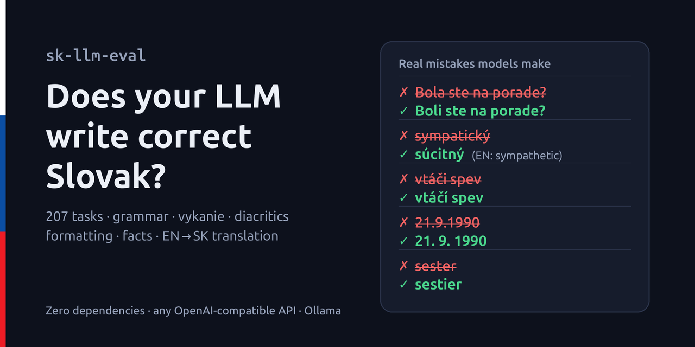

# sk-llm-eval

[English](README.md) · **Slovensky**



**Píše jazykový model správne po slovensky?** Praktický benchmark kvality slovenčiny v odpovediach jazykových modelov.

[](https://github.com/ltchurik/sk-llm-eval/actions/workflows/validate.yml)
[](https://doi.org/10.5281/zenodo.24091954)


Akademické slovenské benchmarky (skLEP, Trojsten) merajú porozumenie textu a riešenie úloh. sk-llm-eval meria to, čo slovenský používateľ alebo firma postrehne ako prvé: skloňovanie, vykanie, diakritiku, dátumy a sumy zapísané po slovensky, slovenské reálie bez halucinácií a preklady bez anglicizmov a vplyvu češtiny.

- **207 úloh v 6 kategóriách**, napísaných priamo pre tento benchmark, nie preložených z angličtiny.
- **Väčšinou deterministické kontroly** (regulárne výrazy, počet slov, podiel diakritiky). Jazykový model ako hodnotiteľ (judge) sa používa len tam, kde odpoveď nemožno overiť regulárnym výrazom.
- **Žiadne závislosti.** Štandardná knižnica Pythonu 3.10+ a ľubovoľné OpenAI-kompatibilné API: OpenAI, OpenRouter, Ollama, vLLM, LM Studio…
- **Reprodukovateľné.** Všetky odpovede a všetky verdikty hodnotiteľa, z ktorých rebríček vychádza, sú v repozitári.

## Rebríček (v0.2.3)

26 riadkov: 4 modely Claude, 6 modelov cez API OpenRouter (GPT, Gemini, Grok, DeepSeek, Mistral, Llama) a 14 modelov s otvorenými váhami spustených lokálne; Qwen 3.5 4B a 9B sú v tabuľke dvakrát, s vypnutým aj zapnutým premýšľaním.

| # | Model | Celkovo | Gramatika | Register | Reálie | Formát | Preklad | Dlhý text |
|---|---|---|---|---|---|---|---|---|
| 1 | Claude Opus (agent) | **100,0** | 100,0 | 100,0 | 100,0 | 100,0 | 100,0 | 100,0 |
| 2 | Claude Fable 5.1 (chat) | **99,4** | 100,0 | 96,2 | 100,0 | 100,0 | 100,0 | 100,0 |
| 3 | GPT-6.1 Sol (OpenRouter) | **98,7** | 100,0 | 100,0 | 100,0 | 100,0 | 100,0 | 92,3 |
| 4 | Gemini 4 Argon (OpenRouter) | **97,0** | 100,0 | 100,0 | 100,0 | 97,4 | 100,0 | 84,6 |
| 5 | DeepSeek V4 Pro (OpenRouter) | **96,9** | 100,0 | 96,2 | 100,0 | 100,0 | 92,9 | 92,3 |
| 6 | Claude Sonnet (agent) | **95,7** | 98,6 | 100,0 | 97,9 | 100,0 | 92,9 | 84,6 |
| 7 | Grok 4.7 (OpenRouter) | **94,5** | 94,2 | 88,5 | 100,0 | 100,0 | 100,0 | 84,6 |
| 8 | Claude Haiku (agent) | **93,1** | 94,2 | 88,5 | 93,6 | 97,4 | 92,9 | 92,3 |
| 9 | Mistral Large 4 (OpenRouter) | **88,5** | 78,3 | 84,6 | 95,7 | 94,7 | 92,9 | 84,6 |
| 10 | Gemma 4 26B-A4B (Ollama) | **76,6** | 75,4 | 88,5 | 85,1 | 86,8 | 92,9 | 30,8 |
| 11 | Llama 4 Maverick (OpenRouter) | **76,0** | 79,7 | 76,9 | 89,4 | 86,8 | 100,0 | 23,1 |
| 12 | Qwen 3.8 27B Q8 (Ollama, bez premýšľania) | **69,4** | 69,6 | 69,2 | 61,7 | 84,2 | 92,9 | 38,5 |
| 13 | Qwen 3.5 9B (Ollama, s premýšľaním) | **63,6** | 68,1 | 61,5 | 70,2 | 73,7 | 92,9 | 15,4 |
| 14 | Gemma 4 12B (Ollama) | **58,8** | 62,3 | 61,5 | 61,7 | 73,7 | 85,7 | 7,7 |
| 15 | Gemma 3 12B (Ollama) | **58,3** | 63,8 | 61,5 | 59,6 | 63,2 | 78,6 | 23,1 |
| 16 | Ornith 1.5 35B (Ollama) | **57,8** | 56,5 | 50,0 | 72,3 | 73,7 | 71,4 | 23,1 |
| 17 | Qwen 3.5 9B (Ollama, bez premýšľania) | **52,9** | 55,1 | 38,5 | 59,6 | 63,2 | 85,7 | 15,4 |
| 18 | Gemma 4 E4B (Ollama) | **47,3** | 47,8 | 38,5 | 51,1 | 52,6 | 78,6 | 15,4 |
| 19 | Qwen 3.5 4B (Ollama, s premýšľaním) | **44,2** | 53,6 | 30,8 | 53,2 | 63,2 | 64,3 | 0,0 |
| 20 | Laguna XS 2.1 Q8 (Ollama) | **41,1** | 34,8 | 19,2 | 57,4 | 63,2 | 64,3 | 7,7 |
| 21 | Qwen 3.5 4B (Ollama, bez premýšľania) | **39,9** | 49,3 | 19,2 | 42,6 | 63,2 | 57,1 | 7,7 |
| 22 | Gemma 3 4B (Ollama) | **36,0** | 37,7 | 30,8 | 34,0 | 34,2 | 71,4 | 7,7 |
| 23 | Granite 4.1 8B (Ollama) | **34,1** | 43,5 | 15,4 | 42,6 | 52,6 | 42,9 | 7,7 |
| 24 | Mistral Nemo 12B (Ollama) | **21,6** | 31,9 | 11,5 | 46,8 | 39,5 | 0,0 | 0,0 |
| 25 | Llama 3.2 3B (Ollama) | **14,5** | 24,6 | 7,7 | 21,3 | 18,4 | 7,1 | 7,7 |
| 26 | Phi-4 mini 3.8B (Ollama) | **13,0** | 15,9 | 3,8 | 25,5 | 18,4 | 14,3 | 0,0 |

Skóre = percento úloh, ktoré prešli všetkými kontrolami; Celkovo = priemer skóre kategórií. Úplná tabuľka s hodnotiteľom a dátumami je v súbore [`results/LEADERBOARD.md`](results/LEADERBOARD.md). Skôr než riadky porovnáte, prečítajte si, [ako vznikli výsledky](#ako-vznikli-výsledky).

## V čom sa modely mýlia

Skutočné odpovede 24 modelov uvedených vyššie (jeden beh na model, bez variantov s premýšľaním):

| Úloha | Správne | Chybné odpovede |
|---|---|---|
| Sídlo Ústavného súdu SR | Košice | Bratislava (13 z 24 modelov) |
| Najväčší samosprávny kraj | Banskobystrický | Košický, Prešovský (13 z 24) |
| *He is a very sympathetic person.* | *súcitný, empatický* | *sympatický* (13 z 24) |
| Sadzba DPH od 1. 1. 2025 | 23 % | 20 % (12 z 24) |
| *sestra*, genitív plurálu | *sestier* | *sester*, *sestr* (11 z 24) |
| Dátum 21. septembra 1990 číslicami | *21. 9. 1990* | *21.9.1990*, *21. septembra 1990* (8 z 24) |
| *vtáči*, alebo *vtáčí spev*? | *vtáčí* (výnimka z rytmického krátenia) | *vtáči* (5 z 24) |
| *Bola si včera na porade?* → vykanie | *Boli ste…* | *Bola ste…*, podľa českého vzoru (4 z 24) |

Niektoré malé modely zablúdia do susedného jazyka: Mistral Nemo preložil vetu *Eventually, we found the problem* ako *Končno smo našli problem*, čo je slovinčina.

## Kategórie

| Kategória | Úlohy | Čo meria |
|---|---|---|
| Gramatika (`gramatika`) | 69 | skloňovanie, i/y, rytmické krátenie a jeho výnimky, slovesné tvary, číslovky slovom, bohemizmy, veľké písmená |
| Register (`register`) | 26 | vykanie a tykanie, oslovenia, formálne listy, spisovný a hovorový štýl |
| Reálie (`realie`) | 47 | slovenské inštitúcie, právo, geografia a dejiny; pasce na halucinácie |
| Formát (`format`) | 38 | dátumy, čísla, meny, telefónne čísla, PSČ, tituly, skratky, úvodzovky |
| Preklad (`preklad`) | 14 | z angličtiny do slovenčiny: idiómy, falošní priatelia (*actual*, *eventually*, *sympathetic*), zhoda v rode a páde |
| Dlhý text (`long_text`) | 13 | texty so 100–300 slovami: dôsledná diakritika a register, bez anglicizmov, dopĺňanie diakritiky |

V zátvorkách sú identifikátory kategórií, ktoré sa používajú v súboroch `tasks/<id>.jsonl` a vo výsledkoch.

Zadania aj hodnotiace kritériá sú zámerne po slovensky: benchmark skúma, ako sa model správa k slovenskému používateľovi.

## Rýchly štart

```bash
git clone https://github.com/ltchurik/sk-llm-eval && cd sk-llm-eval

# OpenAI
export OPENAI_API_KEY=sk-...
python -m sk_llm_eval.run --model gpt-4o --judge-model gpt-4o

# OpenRouter: jeden kľúč, všetky modely
export SK_EVAL_API_KEY=sk-or-...
python -m sk_llm_eval.run --base-url https://openrouter.ai/api/v1 \
  --model mistralai/mistral-large --judge-model openai/gpt-4o

# lokálny model cez Ollamu
python -m sk_llm_eval.run --base-url http://localhost:11434/v1 --model qwen2.5:7b

# znova vygenerovať rebríček z results/*.json
python -m sk_llm_eval.leaderboard
```

Bez `--judge-model` sa úlohy pre hodnotiteľa preskočia a do skóre sa nezapočítajú; deterministické úlohy sa spustia vždy.

### Modely s premýšľaním a lokálne modely

```bash
# dajte modelu s premýšľaním dosť priestoru…
python -m sk_llm_eval.run --base-url http://localhost:11434/v1 --model my-model \
  --max-tokens 8192 --timeout 900

# …alebo premýšľanie vypnite
python -m sk_llm_eval.run --base-url http://localhost:11434/v1 --model my-model \
  --max-tokens 1500 --extra-body '{"reasoning_effort": "none"}'
```

- Odpovede sa priebežne zapisujú do `results/answers/<model>.jsonl`. Ak sa beh preruší, `--resume` v ňom pokračuje a API dostane len úlohy, ktoré ešte nemajú odpoveď.
- Bloky `<think>…</think>` sa pred kontrolou odstránia.
- `--extra-body` pridá do tela požiadavky ľubovoľný JSON.

### Hodnotenie odpovedí získaných inde

Pri modeloch dostupných len cez chat alebo pri opätovnom hodnotení po zmene kontrol uložte odpovede do súboru JSONL, jeden riadok `{"id": "...", "answer": "..."}` na úlohu:

```bash
python -m sk_llm_eval.score --answers results/answers/my-model.jsonl --label "My Model (chat)"
# verdikty hodnotiteľa získané samostatne
python -m sk_llm_eval.score --answers ... --label ... --judge-file verdicts.jsonl --judge-label "GPT-4o"
```

## Ako sa hodnotí

Každá úloha má zoznam kontrol a **prejde, len ak prejdú všetky jej kontroly**.

```jsonc
{
  "id": "register-024",
  "category": "register",
  "prompt": "Prepíš do vykania. Otázka je adresovaná žene: Bola si včera na porade?",
  "checks": [
    {"type": "regex", "value": "\\bBoli ste\\b", "flags": "i"},
    {"type": "not_regex", "value": "\\bBola ste\\b", "flags": "i"}
  ]
}
```

| Kontrola | Význam |
|---|---|
| `contains` / `not_contains` | podreťazec bez ohľadu na veľkosť písmen |
| `exact` | normalizovaná odpoveď sa rovná hodnote |
| `regex` / `not_regex` | `re.search`; `"flags": "i"` ignoruje veľkosť písmen |
| `min_words` / `max_words` | hranice počtu slov |
| `diacritics_ratio` | podiel slov so slovenskou diakritikou ≥ hodnota (odhalí text bez diakritiky) |
| `judge` | hodnotiaci model dá odpovedi 0–10 bodov podľa kritérií v `rubric`; úloha prejde pri 7 a viac bodoch |

Pred kontrolou sa odpovede normalizujú: NFC, nezlomiteľné medzery sa nahradia bežnými, viacnásobné medzery sa zlúčia a odstráni sa zvýraznenie v Markdowne (`**…**`). Kontrola `not_regex` zlyhá aj vtedy, keď sa nesprávny tvar objaví len vo vysvetlení. Ak úloha žiada jedno slovo alebo opravenú vetu, odpoveďou má byť len to.

## Ako vznikli výsledky

Všetky podrobnosti (presné príkazy, digesty modelov, Modelfiles, prompt a dávky hodnotenia) sú v [docs/METHODOLOGY.md](docs/METHODOLOGY.md) (po anglicky).

- **Riadky `(Ollama)`** sú čisté behy cez API modelov s otvorenými váhami na NVIDIA DGX Spark cez OpenAI-kompatibilné rozhranie Ollamy, s teplotou 0 a predvoleným systémovým promptom. Modely používajú predvolenú kvantizáciu Ollamy (Q4_K_M; Mistral Nemo Q4_0), ak názov neuvádza Q8. Presné nastavenia sú v poli `run_settings` v súbore `results/<model>.json`.
- **Premýšľanie.** Modely, ktoré predvolene premýšľajú, ho mali zapnuté s limitom 8192 tokenov. Riadky Qwen `bez premýšľania` bežali s vypnutým premýšľaním (`reasoning_effort: none`); hustý Qwen 3.8 27B generuje na tomto stroji asi 5 tokenov za sekundu, čo je na beh s premýšľaním príliš pomaly.
- **Riadky Qwen `s premýšľaním`** bežali so zapnutým premýšľaním, kontextom 32k a limitom 16 384 tokenov, s nastavením vzorkovania, ktoré Qwen odporúča pre premýšľanie (teplota 0,6, top_p 0,95, top_k 20, presence_penalty 1,5). Pri teplote 0 sa modely v premýšľaní zacyklili. Premýšľanie zdvihne Qwen 3.5 9B z 52,9 na 63,6 a 4B z 39,9 na 44,2, za cenu asi 5 minút na úlohu. Pomáha pri gramatike, reáliách a registri, no nie pri dlhých textoch.
- **Prázdna odpoveď sa počíta ako zlyhanie.** Gemma 4 12B (11 úloh), Gemma 4 26B-A4B (9), Laguna (5), Ornith (3) a Qwen 3.5 4B (16) a 9B (4) s premýšľaním vrátili pri niektorých úlohách prázdnu odpoveď, najpravdepodobnejšie preto, že premýšľanie minulo celý limit tokenov.
- **Riadky `(OpenRouter)`** sú čisté behy cez API OpenRouter s teplotou 0, limitom 8192 tokenov a predvoleným systémovým promptom. Premýšľanie ostalo na predvolenom nastavení každého poskytovateľa. Mistral Large 4 vrátil pri 3 úlohách prázdnu odpoveď. Všetkých šesť behov stálo spolu asi 1,70 $.
- **Riadky `(agent)`**: model Claude bežal ako subagent v Claude Code a videl len zadania, nie kontroly. Nejde o čistý beh cez API, pretože prostredie pridáva vlastný systémový prompt.
- **Riadok `(chat)`**: autor úloh nechal tento model odpovedať na úlohy z v0.1.0 v chate a na úlohy z v0.2.0 odpovedal ten istý model ako subagent. Berte ho ako kontrolu správnosti úloh.
- **Hodnotiteľ**: úlohy pre hodnotiteľa naslepo ohodnotil Claude Opus. Odpovede všetkých 26 riadkov na tú istú úlohu sa hodnotili spolu v jednom kole, zamiešané a označené len písmenami A, B, C… Stále však ide o model Claude, ktorý hodnotí modely Claude, preto treba počítať s istým zvýhodnením vlastnej rodiny modelov. Všetky verdikty sú v priečinku `results/judge/`.
- **Vrchol rebríčka**: Opus prešiel všetkými 207 úlohami, Fable a GPT-6.1 Sol neprešli každý jednou úlohou pre hodnotiteľa a ďalších päť modelov má medzi 93 a 97. Opus je zároveň hodnotiteľ, preto jeho 100 nepreceňujte. Benchmark dobre rozlišuje stredné modely a modely s otvorenými váhami (od 13 % do 89 %), no najsilnejšie modely zatiaľ od seba neodlíši.

Skóre sú porovnateľné len v rámci jednej verzie úloh. Pozrite [CHANGELOG.md](CHANGELOG.md).

## Ako prispieť

Najviac pomôžu:

1. **Behy ďalších rodín modelov** (GPT, Gemini, Mistral, Llama…) cez ich API. Pridajte `results/<model>.json` a `results/answers/<model>.jsonl`.
2. **Ťažšie úlohy**, najmä také, na ktorých zlyhávajú aj najsilnejšie modely.

Pravidlá pre úlohy:

- Jedna úloha je jeden riadok JSONL v súbore `tasks/<kategória>.jsonl` s `id` v tvare `<kategória>-NNN`, ktoré pokračuje v číslovaní.
- Uprednostnite deterministické kontroly a `judge` použite len tam, kde odpoveď nemožno overiť regulárnym výrazom.
- Každú kontrolu otestujte na správnej odpovedi aj na typickej chybnej. Kontrola, ktorá zamietne správnu odpoveď, je horšia ako žiadna.
- Pri faktoch uveďte `"source"` (URL). Pri údajoch, ktoré sa menia (sadzby, funkcionári), pridajte `"volatile": true`.
- Spustite `python -m sk_llm_eval.validate` a `python -m unittest discover -s tests`. CI ich spúšťa pri každom PR.

Nápady na nové kategórie: `agent` (volanie nástrojov po slovensky), `sumar` (zhrnutia slovenských textov bez halucinácií) a dlhé texty s viac ako 500 slovami.

## Citovanie

Použite [CITATION.cff](CITATION.cff); tlačidlo „Cite this repository“ na GitHube ho zobrazí. DOI [10.5281/zenodo.24091954](https://doi.org/10.5281/zenodo.24091954) pokrýva všetky verzie.

## Licencia

MIT. Všetky úlohy sú pôvodné a nevychádzajú z iných dátových súborov.
